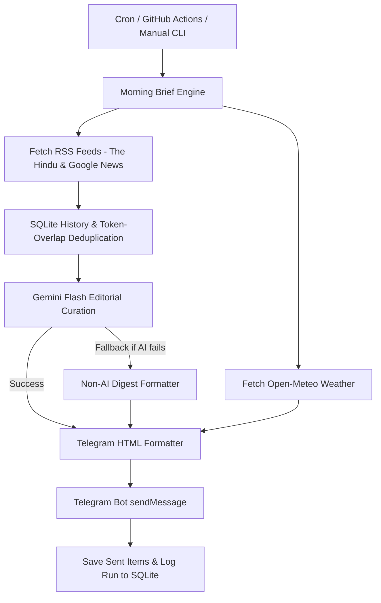

# ☀️ Morning Brief — Personal News & Weather Briefing Service

**Morning Brief** is an automated, personal news editor and weather briefing service designed for Coimbatore, Tamil Nadu, India. Every morning at **07:30 IST**, it aggregates news from high-quality RSS feeds, deduplicates stories using title normalization and token-overlap algorithms, curates top headlines using Google Gemini Flash, and delivers a clean HTML digest directly to your Telegram bot.

---

## 🌟 Key Features

- **Automated Scheduling**: Scheduled for **07:30 Asia/Kolkata (02:00 UTC)** daily via APScheduler, Docker, or GitHub Actions.
- **Smart Deduplication**: SQLite-backed history (72-hour window) and token-overlap similarity (>80%) to eliminate duplicate stories across sources.
- **AI-Powered Curation**: Selects factual, high-impact stories while filtering out noise, gossip, and promotional content using Google Gemini Flash.
- **Fail-Safe Fallback**: Automatic fallback to top raw RSS headlines if Gemini API fails or returns invalid JSON.
- **Open-Meteo Weather**: Accurate Coimbatore weather, max/min temperatures, and plain-English rain/umbrella forecasts.
- **Telegram HTML Formatting**: Strictly formatted, clean HTML links under 4,000 characters with auto-truncation logic.
- **GitHub Actions Ready**: Manual trigger (`workflow_dispatch`) and automatic cron scheduling with persistent database caching.

---

## 🏗️ Project Architecture



---

## 📁 Repository Structure

```text
morning-brief/
├── .github/
│   └── workflows/
│       └── morning_brief.yml    # GitHub Actions cron & manual workflow
├── morning_brief/
│   ├── __init__.py
│   ├── config.py                # Configuration loader & RSS feed definitions
│   ├── db.py                    # SQLite schema, deduplication history & metrics
│   ├── dedupe.py                # Title normalization & token overlap similarity
│   ├── rss.py                   # Async RSS parser with 24h filter
│   ├── weather.py               # Open-Meteo forecast client & WMO code mapper
│   ├── gemini.py                # Gemini Flash client with JSON schema enforcement
│   ├── formatter.py             # Telegram HTML builder & character limiter
│   ├── telegram.py              # Telegram HTTP API sender
│   ├── scheduler.py             # APScheduler entrypoint for 07:30 IST
│   └── main.py                  # CLI entrypoint (run / schedule)
├── config.yaml                  # Feed definitions & operational parameters
├── .env.example                 # Secrets template
├── requirements.txt             # Python dependencies
├── Dockerfile                   # Production Docker image
├── docker-compose.yml           # Container orchestration
└── README.md                    # Project documentation
```

---

## 🔑 Setup & Configuration

### 1. Telegram Bot Setup
1. Open Telegram and search for **[@BotFather](https://t.me/BotFather)**.
2. Send `/newbot` and follow the prompts to create your bot. Copy the **Bot API Token**.
3. Search for **[@userinfobot](https://t.me/userinfobot)** or **[@RawDataBot](https://t.me/RawDataBot)** in Telegram, send any message, and copy your numeric **Chat ID**.
4. Send a `/start` message to your newly created bot to enable messaging.

### 2. Environment Variables (`.env`)
Copy `.env.example` to `.env` and fill in your keys:

```bash
cp .env.example .env
```

```env
TELEGRAM_BOT_TOKEN=123456789:ABCdefGhIJKlmNoPQRsTUVwxyZ
TELEGRAM_CHAT_ID=987654321
GEMINI_API_KEY=AIzaSyYourGeminiApiKeyHere
GEMINI_MODEL=gemini-2.0-flash
TIMEZONE=Asia/Kolkata
BRIEFING_TIME=07:30
DEDUPE_WINDOW_HOURS=72
```

---

## 🚀 Execution & Deployment Options

### Option A: GitHub Actions (Recommended)
You can host this repository on GitHub and let GitHub Actions deliver your daily briefing automatically!

1. Push this repository to your GitHub account.
2. Go to **Settings > Secrets and variables > Actions** in your GitHub repository.
3. Add the following repository secrets:
   - `TELEGRAM_BOT_TOKEN`
   - `TELEGRAM_CHAT_ID`
   - `GEMINI_API_KEY`
4. The workflow will automatically trigger at **07:30 IST (02:00 UTC)** every morning.
5. To test manually, go to the **Actions** tab in GitHub, select **Morning Brief Dispatcher**, and click **Run workflow**.

---

### Option B: Local / Server Python Execution

1. Create a virtual environment and install dependencies:
   ```bash
   python -m venv venv
   source venv/bin/activate  # On Windows: venv\Scripts\activate
   pip install -r requirements.txt
   ```

2. Run a one-time briefing immediately:
   ```bash
   python -m morning_brief.main run
   ```

3. Run the persistent 07:30 IST daemon scheduler:
   ```bash
   python -m morning_brief.main schedule
   ```

---

### Option C: Docker & Docker Compose

1. Build and run using Docker Compose:
   ```bash
   docker-compose up -d --build
   ```

2. Check container logs:
   ```bash
   docker logs -f morning_brief_service
   ```

---

## 🧪 Testing & Verification

To verify that your setup is working properly:

```bash
# Test manual run
python -m morning_brief.main run
```

You should see logs indicating RSS feed fetching, deduplication, weather retrieval, Gemini curation, and a successful Telegram delivery response!
